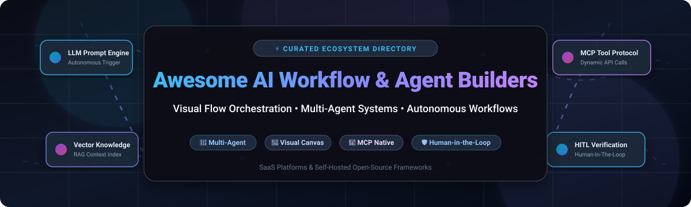

 

  <b>A curated list of visual AI workflow automation platforms, autonomous agent orchestration engines, and multi-agent development frameworks (SaaS & Open-Source).</b>

---

## 📑 Table of Contents

- [🌟 Overview](#-overview)
- [📈 Sector Overview & Market Dynamics](#-sector-overview--market-dynamics)
- [☁️ SaaS & Hosted Platforms](#️-saas--hosted-platforms)
- [💻 Open-Source Agent & Workflow Builders](#-open-source-agent--workflow-builders)
  - [⭐ Open-Source Projects Ranked by Stars](#-open-source-projects-ranked-by-stars)
  - [🔍 Deep Dive: Top Open-Source Frameworks](#-deep-dive-top-open-source-frameworks)
- [📊 Feature & Ecosystem Comparison Matrix](#-feature--ecosystem-comparison-matrix)
- [🎯 How to Choose an AI Agent Builder](#-how-to-choose-an-ai-agent-builder)
- [🤝 How to Contribute](#-how-to-contribute)
- [💖 Support & Community](#-support--community)
- [📜 Star History](#-star-history)
- [⚖️ Disclaimer](#️-disclaimer)

---

## 🌟 Overview

Welcome to the definitive directory for **AI Workflow Builders**, **Visual LLM Orchestration Tools**, and **Autonomous Agent Frameworks**.

As the generative AI ecosystem matures from raw prompt engineering to complex agentic reasoning, teams need structured orchestration layers to coordinate LLM calls, RAG pipelines, external APIs, and deterministic logic. This repository catalogues the leading production tools across SaaS platforms and self-hosted open-source software.

### 🚀 Key Architectural Pillars Tracked:
- 🎨 **Visual Drag-and-Drop Canvases**: Node-based graph programming for seamless agent composition.
- 🤖 **Autonomous & Multi-Agent Orchestration**: Hierarchical swarms, supervisor-agent workflows, and collaborative loops.
- 📚 **Retrieval-Augmented Generation (RAG)**: Document chunking, hybrid vector search, and reranking pipelines.
- 🔌 **Model Context Protocol (MCP)**: Universal standard interfaces enabling AI agents to query external tools and environments seamlessly.
- 🛡️ **Human-in-the-Loop (HITL)**: Deterministic guardrails, approval gates, and rollback policies for critical operations.
- 📊 **LLMOps & Tracing**: Step-by-step latency analysis, token consumption tracking, and eval metrics.

---

## 📈 Sector Overview & Market Dynamics

The global market for AI workflow automation and intelligent process orchestration is currently estimated between **$25B and $30B**, rapidly accelerating toward an estimated **$50B to $85B+ by 2030** with an annual growth rate (CAGR) exceeding 20%.

**Market Concentration & Dynamics**: The sector is **highly fragmented** rather than a winner-take-all monopoly. Competition spans across hyperscalers (Microsoft, Google, AWS), enterprise low-code incumbents (UiPath, ServiceNow, Retool), and dedicated open-source visual agent builders (Dify, Langflow, Flowise, n8n). Organizations consistently favor hybrid ecosystems that combine open standards like the **Model Context Protocol (MCP)** with custom orchestration backends to avoid single-vendor lock-in.

---

## ☁️ SaaS & Hosted Platforms

The table below catalogs premier cloud-hosted AI agent and workflow building platforms, ranked in descending order by estimated company valuation / size.

| Platform | Company Valuation / Revenue | Primary Focus | Pricing Starting Tier | Free Tier & Free Trial Limits | Key Highlights |
| :--- | :--- | :--- | :--- | :--- | :--- |
| **[Retool](https://retool.com/)** | **$3.2 Billion Valuation** (~$120M ARR) | Enterprise Internal Apps & AI Agents | **$10 / user / month** (Team tier, billed annually; $12/mo billed monthly; Business at $50/user/mo) | **Free Forever Plan**: Up to 5 users, full access to standard database & API connectors, Retool Cloud access (Retool Agents currently in public beta) | Enterprise RBAC, SSO, audit logging, proprietary MCP server support, 100+ native enterprise connectors |
| **[Botpress Cloud](https://botpress.com/)** | **$120 Million Valuation** ($25M Series B) | Conversational AI & Autonomous Bots | **$150 / month** (Plus plan; Team plan at $495/mo) | **Free Forever Plan**: Unlimited bots, $5 USD monthly included AI execution spend, access to standard web and chat channels | Visual flow builder, native NLU engine, hybrid RAG knowledge base, automated multi-channel messaging |
| **[Stack AI](https://www.stack-ai.com/)** | **$75 Million Acquisition** (Acquired by Asana) | Enterprise AI Workflow & RAG Automation | **$199 / month** (Starter plan; Enterprise custom quote) | **Free Forever Plan**: 1 seat, 2 projects, and up to 500 workflow runs / month with community Discord support | Visual prompt flow canvas, SOC 2 / HIPAA compliance, enterprise vector integrations, multi-agent chains |
| **[Lindy](https://www.lindy.ai/)** | **$54 Million+ Total Funding** (Series A) | Autonomous Business Process Agents | **$29.99 / user / month** (Plus plan; Pro plan at $49.99/mo) | **7-Day Free Trial**: 7-day unrestricted trial with starter execution credits, no credit card required upfront (no permanent free tier) | Turnkey agent templates, native integrations with Gmail, Google Calendar, Slack, and Salesforce |
| **[Voiceflow](https://www.voiceflow.com/)** | **$35 Million+ Total Funding** (Series A/B) | Conversational Agent & Voice Design | **$50 / editor / month** (Pro plan, billed monthly; $40/mo billed annually) | **Free Forever Plan**: Up to 2 editors, 100,000 Knowledge Base tokens, 100 monthly AI agent credits, unlimited prototypes | Collaborative conversation canvas, live prototyping, omni-channel deployment (Web, WhatsApp, telephony) |
| **[SuperAGI Cloud](https://superagi.com/)** | **$25 Million - $50 Million Valuation** (~$15M Funding) | Autonomous Agent Swarms & Growth Tools | **$49 / user / month** (Growth / Pro plan) | **Free Forever Plan**: 100 action credits / month, access to core tool marketplace, single active agent execution limit | Agent marketplace with 70+ tools, concurrent background agent loops, sales automation and SDR agent actions |

---

## 💻 Open-Source Agent & Workflow Builders

Self-hosted, transparent, and developer-friendly frameworks giving engineering teams total data ownership, privacy, and unlimited deployment flexibility.

### ⭐ Open-Source Projects Ranked by Stars

The following list comprises the most widely adopted open-source AI agent builders and orchestration engines, ranked strictly by GitHub star count (descending):

1. **[n8n](https://github.com/n8n-io/n8n)**  — Fair-code workflow automation with native AI agent nodes, LangChain connectors, and 400+ pre-built integration nodes.
2. **[AutoGPT](https://github.com/Significant-Gravitas/AutoGPT)**  — Pioneering autonomous agent framework and visual builder for running recursive agent loops.
3. **[Dify](https://github.com/langgenius/dify)**  — Complete open-source LLM app development platform combining visual workflows, RAG pipelines, agents, and LLMOps monitoring.
4. **[Open-WebUI](https://github.com/open-webui/open-webui)**  — Extensible, feature-rich self-hosted AI interface supporting custom functions, Pipelines workflow engine, and multi-agent chats.
5. **[Langflow](https://github.com/langflow-ai/langflow)**  — Visual drag-and-drop authoring environment for AI agents and workflows; natively turns flows into APIs and MCP servers.
6. **[Browser-Use](https://github.com/browser-use/browser-use)**  — Autonomous web browsing agent framework allowing AI models to interact with websites and execute automated web workflows.
7. **[RAGFlow](https://github.com/infiniflow/ragflow)**  — Deep document understanding-based open-source RAG engine and visual agent workflow orchestration platform.
8. **[OpenHands](https://github.com/All-Hands-AI/OpenHands)**  — Autonomous software development AI agent platform capable of coding, debugging, and terminal workflow execution.
9. **[MetaGPT](https://github.com/geekan/MetaGPT)**  — Multi-agent meta-programming framework assigning collaborative roles (Product Manager, Architect, Engineer) to autonomous agents.
10. **[AutoGen (Microsoft)](https://github.com/microsoft/autogen)**  — Multi-agent conversation framework enabling autonomous collaborative task execution.
11. **[CrewAI](https://github.com/crewAIInc/crewAI)**  — Lean multi-agent framework orchestrating role-playing autonomous agents with task hierarchies.
12. **[Flowise](https://github.com/FlowiseAI/Flowise)**  — Drag-and-drop UI platform for building customizable LLM flows, multi-agent systems, and RAG architectures.
13. **[LlamaIndex](https://github.com/run-llama/llama_index)**  — Production-grade data framework and agent workflow system for context-augmented LLM applications.
14. **[LangGraph](https://github.com/langchain-ai/langgraph)**  — Stateful, cyclical multi-agent graph orchestration engine engineered for production reliability.
15. **[ToolJet](https://github.com/ToolJet/ToolJet)**  — Open-source low-code platform for internal enterprise tools with native AI agent nodes and open-source MCP server support.
16. **[Activepieces](https://github.com/activepieces/activepieces)**  — Open-source no-code automation engine featuring 280+ community pieces, each auto-exposed as an MCP server.
17. **[DB-GPT](https://github.com/eosphoros-ai/DB-GPT)**  — Open-source AI native data app development framework with multi-agent orchestration and multi-model management.
18. **[SuperAGI](https://github.com/TransformerOptimus/SuperAGI)**  — Autonomous agent orchestration framework equipped with an action console, 70+ tool integrations, and telemetry monitoring.
19. **[Botpress](https://github.com/botpress/botpress)**  — Developer-first conversational AI and bot-building runtime featuring visual conversation design and multi-channel deployment.
20. **[Rivet](https://github.com/Ironclad/rivet)**  — Visual AI programming environment and TypeScript library for building and embedding complex prompt graphs directly into applications.
21. **[ModelScope Agent](https://github.com/modelscope/modelscope-agent)**  — Customizable agent framework supporting multi-modal tools, memory components, and visual workflow builders.

---

### 🔍 Deep Dive: Top Open-Source Frameworks

#### 1. [Langflow](https://github.com/langflow-ai/langflow)
- **License**: MIT | **Language**: Python / TypeScript
- **Description**: The industry-standard visual drag-and-drop authoring environment for AI agents and multi-step workflows.
- **Key Features**:
  - Automatically exposes any created workflow as both a REST API and a **Model Context Protocol (MCP)** server.
  - Interactive canvas playground for inspecting step-by-step token emissions and node executions.
  - Extensible Python runtime allowing developers to write custom component classes inline.
  - Observability hooks with Langfuse, LangSmith, and Arize Phoenix.

#### 2. [Dify](https://github.com/langgenius/dify)
- **License**: Apache-2.0 derivative | **Language**: Python / Next.js
- **Description**: Full-stack, production-grade LLM application platform engineered for enterprise workflows.
- **Key Features**:
  - Unified interface incorporating visual workflow graphs, RAG knowledge indexing, and autonomous agent loops.
  - Isolated Docker sandbox enabling agents to safely run Python scripts and terminal commands.
  - Enterprise document extraction supporting PDF, Word, PowerPoint, and Markdown files.
  - Native multi-tenant team management, token analytics, and audit logging.

#### 3. [Flowise](https://github.com/FlowiseAI/Flowise)
- **License**: Apache-2.0 | **Language**: TypeScript / React
- **Description**: Lightweight yet extensible visual builder designed for single-agent chats, RAG pipelines, and complex agent swarms.
- **Key Features**:
  - **Three Canvas Modes**: *Assistant* (conversational RAG), *Chatflow* (sequential chains), and *Agentflow* (multi-agent supervisory trees).
  - Built-in Natural Language Generator (*Flowise 3.0*) to generate entire visual workflows from plain-English prompts.
  - Native human-in-the-loop validation checkpoints allowing humans to authorize or reject tool calls.

#### 4. [Rivet](https://github.com/Ironclad/rivet)
- **License**: MIT | **Language**: TypeScript / Electron
- **Description**: Desktop graphical IDE and runtime engine built by Ironclad for creating prompt graphs and executing them natively in backend code.
- **Key Features**:
  - Fast, responsive desktop GUI for designing complex prompt chains and loops.
  - `@ironclad/rivet-core` library enables direct execution of saved `.rivet-project` graphs within Node.js / TypeScript microservices.
  - Zero-latency local debugging with variable inspection and step-through graph execution.

---

## 📊 Feature & Ecosystem Comparison Matrix

| Project / Platform | Architecture Type | Visual Canvas | Multi-Agent Swarms | MCP Native | Self-Hostable | License / Pricing |
| :--- | :--- | :---: | :---: | :---: | :---: | :--- |
| **Langflow** | Open-Source | ✅ | ✅ | ✅ | ✅ | MIT License |
| **Dify** | Open-Source | ✅ | ✅ | ✅ | ✅ | Apache-2.0 (derivative) |
| **Flowise** | Open-Source | ✅ | ✅ | ✅ | ✅ | Apache-2.0 License |
| **n8n** | Open-Source | ✅ | ✅ | ✅ | ✅ | Sustainable Use License |
| **AutoGPT** | Open-Source | ✅ | ✅ | 🟡 (via plugins) | ✅ | MIT License |
| **RAGFlow** | Open-Source | ✅ | ✅ | 🟡 | ✅ | Apache-2.0 License |
| **Activepieces** | Open-Source | ✅ | ✅ | ✅ | ✅ | MIT License |
| **ToolJet** | Open-Source | ✅ | ✅ | ✅ | ✅ | AGPL-3.0 License |
| **Rivet** | Open-Source | ✅ | ✅ | 🟡 (via TS) | ✅ | MIT License |
| **Retool** | SaaS / Hybrid | ✅ | ✅ | ✅ | 🟡 (Enterprise) | Paid ($10-$50/user/mo) |
| **Stack AI** | SaaS | ✅ | ✅ | 🟡 | ❌ | Paid (from $199/mo) |
| **Voiceflow** | SaaS | ✅ | 🟡 | 🟡 | ❌ | Paid (from $50/mo) |
| **Botpress Cloud** | SaaS / Hybrid | ✅ | ✅ | 🟡 | ✅ | Paid (from $150/mo) |
| **Lindy** | SaaS | ✅ | ✅ | 🟡 | ❌ | Paid (from $29.99/mo) |

---

## 🎯 How to Choose an AI Agent Builder

1. ⚡ **For Fast Visual Prototyping**: Choose **[Langflow](https://github.com/langflow-ai/langflow)** or **[Flowise](https://github.com/FlowiseAI/Flowise)** for unmatched speed, intuitive drag-and-drop authoring, and hundreds of ready-to-run component templates.
2. 🏢 **For Complete Enterprise Applications**: Choose **[Dify](https://github.com/langgenius/dify)** when you require built-in RAG pipelines, fine-grained access control, sandbox code execution, and enterprise LLMOps observability.
3. 📦 **For Embedding Graphs in TypeScript Applications**: Choose **[Rivet](https://github.com/Ironclad/rivet)** to visually design logic in a desktop IDE and execute the resulting graphs directly via `@ironclad/rivet-core` in your backend.
4. 🔄 **For General Business & API Workflow Automation**: Choose **[n8n](https://github.com/n8n-io/n8n)** or **[Activepieces](https://github.com/activepieces/activepieces)** to orchestrate complex sequences that blend classic SaaS APIs with autonomous AI agent decision-making.
5. 🛡️ **For Regulated Enterprise Internal Dashboards**: Choose **[Retool](https://retool.com/)** for enterprise-grade SOC 2 / HIPAA compliance, database connectivity, and granular RBAC controls.

---

## 🤝 How to Contribute

Contributions are warmly welcomed! Help keep this directory accurate and comprehensive:

1. 🍴 Fork the repository.
2. 📝 Add or edit entries in [README.md](file:///C:/Users/ishan/Documents/Projects/Awesome-AI-Workflow-Agent-Builders/README.md) following the existing structured formats.
3. 🔍 Verify that descriptions are objective, factual, and backed by official repository links or product pages.
4. 💰 When submitting a SaaS product, **always include exact pricing starting tiers and precise free tier limits**.
5. ⭐ When adding an open-source repository, include the stargazers badge and maintain proper descending star ordering.
6. 🚀 Submit a Pull Request with a clear description of your changes.

---

## 💖 Support & Community

Thank you for exploring and supporting this curated catalog! If this repository has helped you navigate the fast-moving AI workflow ecosystem:

- ⭐ **Star this repository** to stay updated on emerging platforms!
- 🍴 **Fork the repo** to maintain your own custom list or contribute back!
- 📢 **Share with colleagues & teams** building next-generation agent workflows!
- ☕ **Support the maintainer**: If you would like to sponsor ongoing research and curation, feel free to [Sponsor on GitHub](https://github.com/sponsors/ishandutta2007)!

---

## 📜 Star History

---

## ⚖️ Disclaimer

- This list is independently curated by the community — it is not sponsored or an official endorsement of any listed tool.
- Always apply **Human-in-the-Loop (HITL)** safeguards when granting autonomous agents write permissions, credential access, or external webhook trigger abilities.
- All product logos, names, and trademarks belong to their respective copyright holders.
